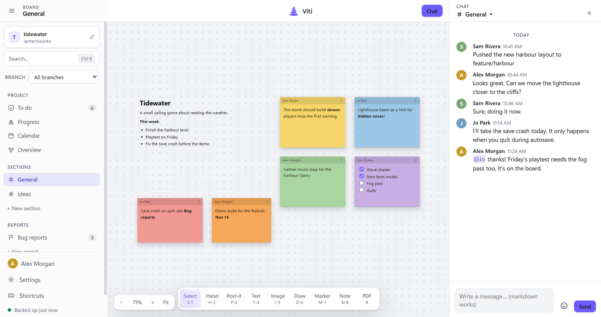
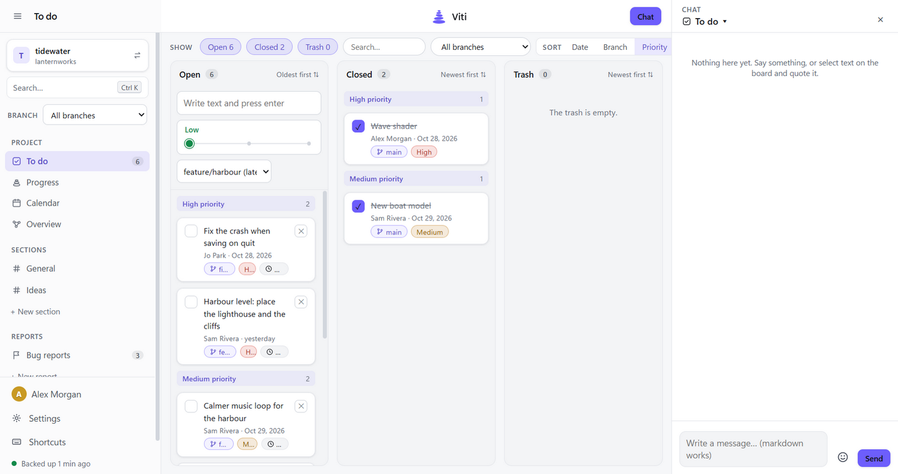
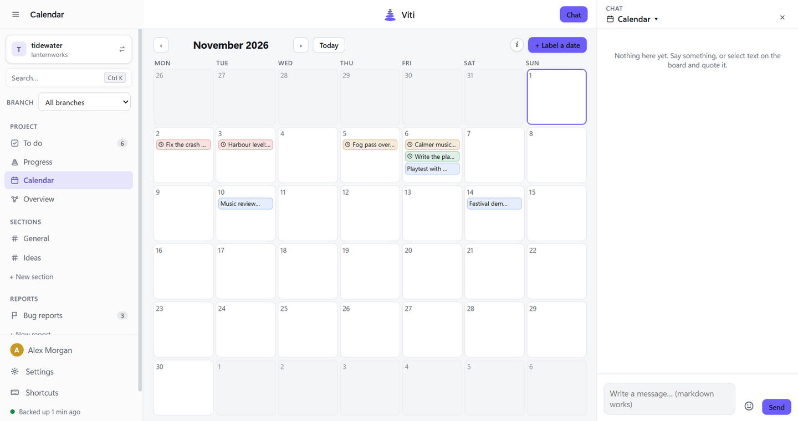
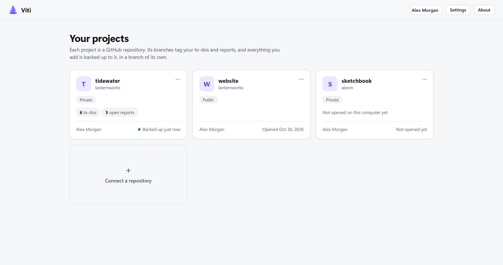

# Viti

**A shared workspace for your project on GitHub.** Boards, chat, to-dos, bug reports, a calendar and a mailbox for any repository, in one window. Everything is backed up to the repository itself, and your team sees each other's changes live.

Free and open source, for Windows, Mac and Linux.

**Download:** [Windows](https://github.com/ionodev/viti/releases/latest/download/Viti-Windows-Setup.exe) · [Mac](https://github.com/ionodev/viti/releases/latest/download/Viti-Mac.dmg) · [Linux](https://github.com/ionodev/viti/releases/latest/download/Viti-Linux.AppImage)

## Install

Download the one for your system with the links above, then:

- **Windows:** run it. If Windows says *Windows protected your PC*, click **More info › Run anyway**.
- **Mac** (Apple silicon and Intel): drag Viti to Applications and open it. The first time, macOS can't verify it: click **Done**, then **System Settings › Privacy & Security › Open Anyway**.
- **Linux** (any distribution): make the file runnable (`chmod +x Viti-Linux.AppImage`, or Properties › Allow executing) and open it.

Then **sign in with GitHub** and **pick a repository**. Viti updates itself (on a Mac it tells you when a new version is out). A portable Windows version and a .deb are also on [Releases](https://github.com/ionodev/viti/releases).

## What's in it

- **Boards:** an endless canvas for notes, text, images and drawings, one per section.
- **Chat:** a chat per section; quote anything on a board, mention people with *@name*.
- **To do and reports:** priorities, deadlines and branch tags; lists for bugs or anything else.
- **Calendar, progress and overview:** deadlines at a glance, and what refers to what.
- **Mail:** link a Gmail label and read and answer the project's email together.
- **Search** everything with **Ctrl+K** (**⌘K** on a Mac).

| | |
|---|---|
|  |  |
|  | |

## Your data

Each project is kept on your computer (fast, works offline) and backed up to its repository on GitHub, in a branch of its own; your code is never touched. Teammates' changes come in within about half a minute and are merged with yours, so you can all work at the same time. Sign-ins stay encrypted on your computer. Mail can't be linked in a public repository.

**Gmail:** turn on 2-Step Verification, create an app password called "Viti", make a Gmail label for the project's mail, then in Viti add a **Mailbox** and click **Link a label**.

**GitHub organisations** may need to approve Viti once (organisation settings › Third-party access).

## Feedback and building

Problems or ideas: open an [issue](https://github.com/ionodev/viti/issues).

To build it yourself, with [Node.js](https://nodejs.org): `npm install`, then `npm start` to run it or `npm run dist` to build it. Releases are built by GitHub Actions ([RELEASING.md](RELEASING.md)).
